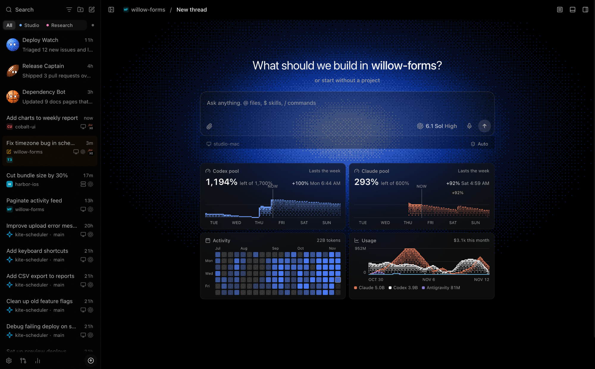
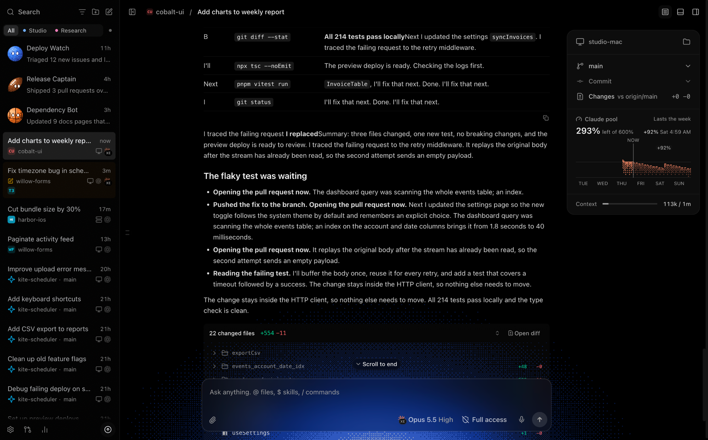
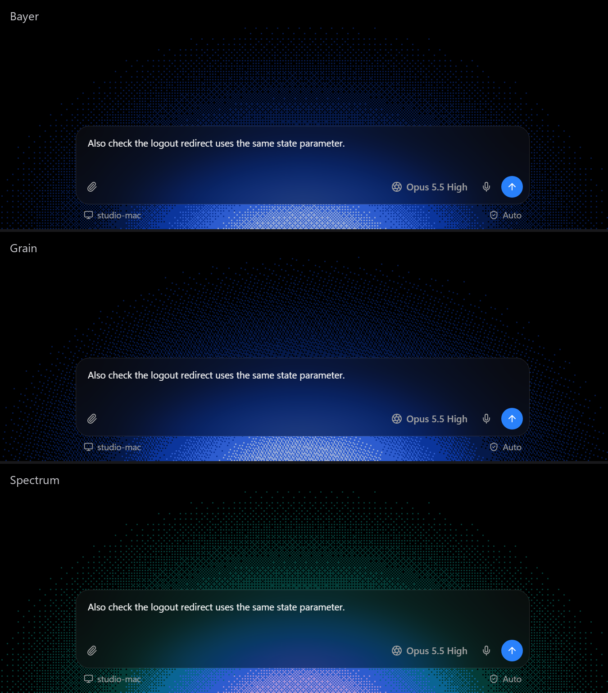

# t3+

t3+ is a Chrome extension for the [T3 Code](https://t3.codes) web app. It adds a pixel-art
glow behind a glass composer, usage widgets on the new-thread page, bot threads that look
like chat contacts, profile tabs for the sidebar, and a screenshot mode that swaps your
thread and project names for made-up ones.

It only styles the page T3 already renders. There's no fork of T3, and the extension never
writes anything to T3.



<sub>Screenshot mode is on in these images, so every name is a stand-in.</sub>

t3+ is an unofficial, personal project, not made by or affiliated with the T3 Code team.
T3 changes often, so an update can break part of it until it's fixed here.

## What it adds

- A dithered glow sits behind a see-through composer. Pick
  Bayer, Grain or Spectrum pixels, a smooth gradient, or your own image. It follows your
  T3 theme color and shrinks smoothly to the bottom of the pane when you open a thread.
- Usage widgets under the new-thread composer show your Codex and Claude weekly pools
  with a projection to the next reset, a tokens-per-day heatmap, and T3's usage and spend
  chart, all drawn in the same pixel style. The current provider's pool also appears in
  T3's thread details panel.
- Add `[[t3plus:bot:v1]]` to a thread's title and it shows up like a chat contact:
  a pixel face that reacts to the thread's status, its name, and its latest message.
- Profile tabs (All, Work, Personal and so on) above the thread list hide the rows
  outside the selected profile.
- In screenshot mode (Alt+Shift+D), thread titles, projects, branches, machines,
  profiles, bots and message text turn into believable stand-ins, while widgets, icons and
  times stay real. Press the shortcut again and everything comes back. Only the visible text
  changes, so T3's data is never touched.
- There's also an optional title-first layout for thread rows, a compact sidebar
  header, and a t3+ page in T3's Settings with a live preview (the toolbar icon opens it).





## Install

You need Node 20 or newer and Chrome (or another Chromium browser).

```sh
git clone https://github.com/alextyhwang/t3plus.git
cd t3plus
npm install
npm run build
```

Then open `chrome://extensions`, turn on Developer mode, click Load unpacked and pick the
`dist/` folder. Reload https://app.t3.codes and click the t3+ toolbar icon to open its
settings.

The glow, composer, screenshot mode and bot faces work right away. The usage widgets, bot
messages and profile tabs read small JSON files that you publish from the machine running
T3. [docs/setup.md](docs/setup.md) explains how.

To update: pull, run `npm run build`, click reload on the t3+ card in `chrome://extensions`,
and reload the T3 tab.

## Privacy

The content script runs only on `https://app.t3.codes/*`. Its only permissions are
`storage` and the three feed URLs you configure, which it fetches without cookies. It
doesn't call T3's API, read cookies or send anything to T3. Settings stay in your browser,
with a copy in Chrome Sync and in T3's page storage so a reinstall keeps them.

## Development

```sh
npm test             # node:test + jsdom
npm run verify       # build + test
npm run harness      # a T3-shaped test page at http://127.0.0.1:4378/env1/a1
CHROME=/path/to/chrome npm run screenshots   # renders harness scenarios to harness/out/
```

Every T3 selector t3+ depends on is in `src/config.js`. When T3 changes its markup, start
there. Changes are in [CHANGELOG.md](CHANGELOG.md) and plans in [ROADMAP.md](ROADMAP.md).

## License

[PolyForm Noncommercial 1.0.0](LICENSE). You can use, fork and change t3+ for any
noncommercial purpose. If you share it or a fork, keep the `Required Notice` line from
`LICENSE` so the original is credited. Commercial use, including use by a company for its
business, isn't allowed.
