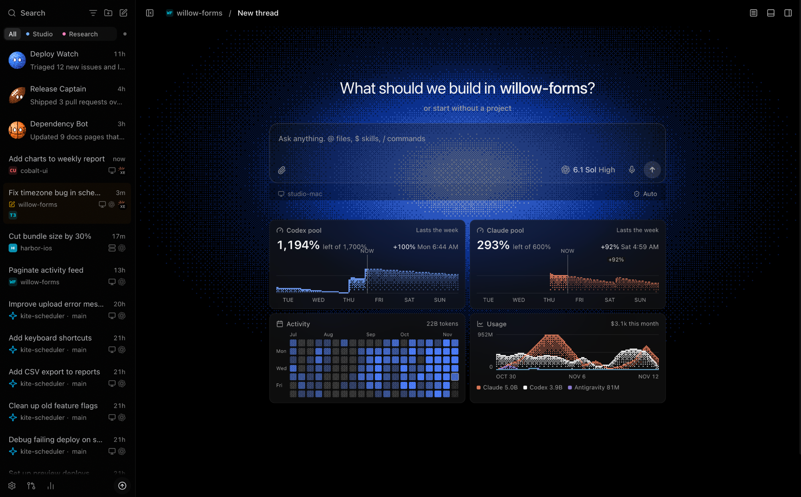
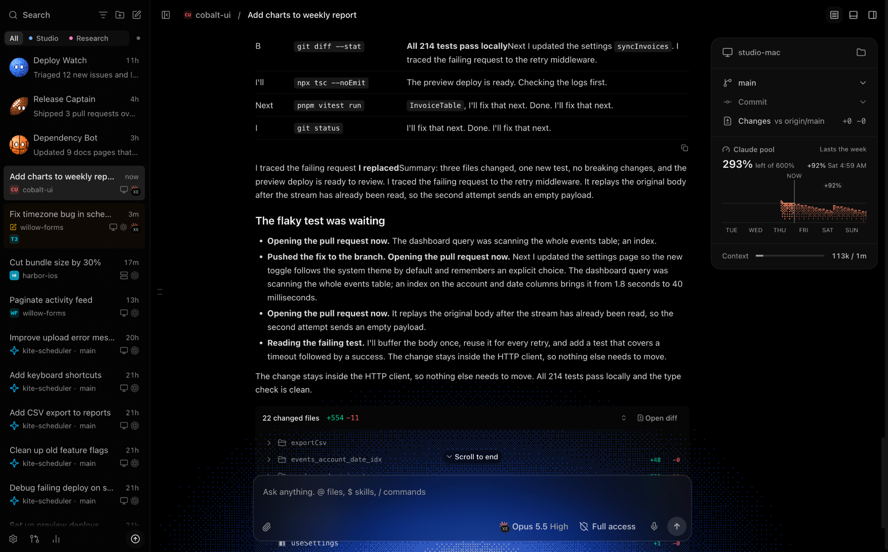

# t3+

t3+ is a Chrome extension for the [T3 Code](https://t3.codes) web app. It adds a pixel-art
glow behind a glass composer, usage widgets on the new-thread page, bot threads that look
like chat contacts, profile tabs for the sidebar, and a screenshot mode that swaps your
thread and project names for made-up ones.

It only styles the page T3 already renders. There's no fork of T3, and the extension never
writes anything to T3.



<sub>Screenshot mode is on in these images, so every name is a stand-in.</sub>

t3+ is an unofficial, personal project, not made by or affiliated with the T3 Code team.
T3 changes often, so an update can break part of it until it's fixed here.

## What it adds

- A dithered glow sits behind a see-through composer. Pick Bayer, Grain or Spectrum
  pixels, a smooth gradient, one of the bundled Aurora, Contours and Facets wallpapers,
  or your own image. It follows your T3 theme color and shrinks smoothly to the bottom
  of the pane when you open a thread.
- Usage widgets under the new-thread composer show your Codex and Claude weekly pools
  with a projection to the next reset, a tokens-per-day heatmap, and T3's usage and spend
  chart, all drawn in the same pixel style. The current provider's pool also appears in
  T3's thread details panel.
- Add `[[t3plus:bot:v1]]` to a thread's title and it shows up like a chat contact:
  a pixel face that reacts to the thread's status, a clean name, and what it's doing
  (approvals and questions first, then running work) or its next scheduled update.
- Profile tabs (All, Work, Personal and so on) above the thread list hide the rows
  outside the selected profile.
- An optional Assistant group puts your bots on top of the thread list, with one router
  bot's threads folded under it. See [docs/assistant-group.md](docs/assistant-group.md).
- A floating browser preview sits below thread details and can expand into the upper
  chat column. See [docs/floating-preview.md](docs/floating-preview.md).
- In screenshot mode (Alt+Shift+D), thread titles, projects, branches, machines,
  profiles, bots and message text turn into believable stand-ins, while widgets, icons and
  times stay real. Press the shortcut again and everything comes back. Only the visible text
  changes, so T3's data is never touched.
- There's also an optional title-first layout for thread rows, a compact sidebar
  header, and a t3+ page in T3's Settings with a live preview (the toolbar icon opens it).



## Install

1. Download `t3plus-vX.Y.Z.zip` from the
   [latest release](https://github.com/alextyhwang/t3plus/releases/latest) and unzip it.
2. Open `chrome://extensions` (or the same page in another Chromium browser) and turn on
   Developer mode.
3. Click Load unpacked and pick the unzipped folder.
4. Reload https://app.t3.codes and click the t3+ toolbar icon to open its settings.

The glow, composer, wallpapers, screenshot mode and bot faces work right away. The usage
widgets, bot status and profile tabs read small JSON files that you publish from the
machine running T3, and they need a build that knows where those files are.
[docs/setup.md](docs/setup.md) explains both.

To update, unzip the new release over the old folder, click reload on the t3+ card in
`chrome://extensions`, and reload the T3 tab. Your settings carry over.

### Building from source

You need Node 20 or newer.

```sh
git clone https://github.com/alextyhwang/t3plus.git
cd t3plus
npm install
npm run build        # writes dist/; load that folder instead
```

Your feed folder and the optional integrations are set in `src/personal.js`
([docs/setup.md](docs/setup.md)).

## Privacy

The content script runs only on `https://app.t3.codes/*`. Its only permissions are
`storage` and the origins you add for your own feeds, which the background worker
fetches at exact URLs without cookies or redirects. It doesn't call T3's API, read
cookies or send anything to T3. Settings stay in your browser, with a copy in Chrome
Sync and in T3's page storage so a reinstall keeps them.

## Development

| Command | What it does |
| --- | --- |
| `npm run build` | build the extension into `dist/` |
| `npm run dev` | rebuild on change |
| `npm test` | unit tests (node:test + jsdom) |
| `npm run verify` | build + test; run before committing |
| `npm run harness` | serve the T3-shaped harness at `http://127.0.0.1:4378/env1/a1` |
| `CHROME=/path/to/chrome npm run screenshots` | render harness scenarios to `harness/out/` |
| `CHROME=/path/to/chrome npm run perf -- --runs 3` | measure t3+'s CPU, storage, Sync and DOM work over a scripted session ([numbers](docs/notes/PERFORMANCE.md)) |
| `npm run release:package` | build `release/t3plus-vX.Y.Z.zip` |
| `npm run release:check` | load that ZIP in Chromium against the harness fixture (needs Python 3.12 and Playwright) |
| `node harness/moods.mjs` | write `harness/out/moods.html` with every bot mood frame |
| `python tools/make_icon.py` | redraw the extension icons (needs Pillow) |

Every T3 selector t3+ depends on is in `src/config.js`. When T3 changes its markup, start
there. Changes are in [CHANGELOG.md](CHANGELOG.md) and plans in [ROADMAP.md](ROADMAP.md).

## License

[PolyForm Noncommercial 1.0.0](LICENSE). You can use, fork and change t3+ for any
noncommercial purpose. If you share it or a fork, keep the `Required Notice` line from
`LICENSE` so the original is credited. Commercial use, including use by a company for its
business, isn't allowed.
